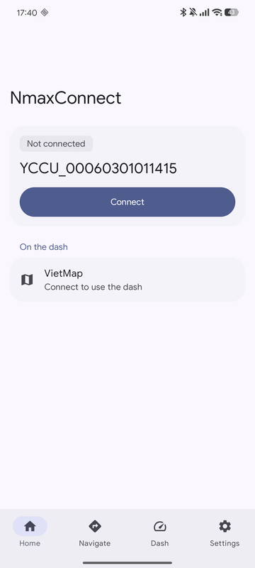
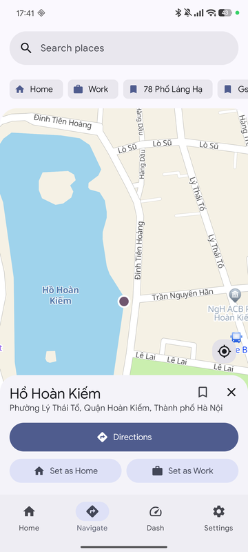
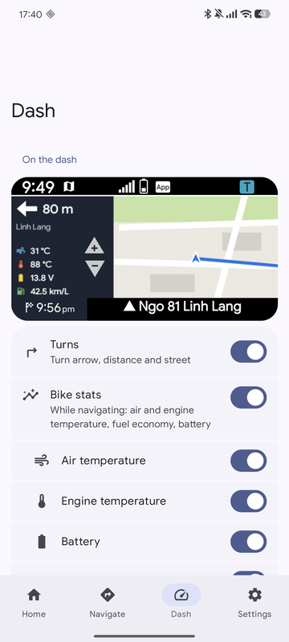
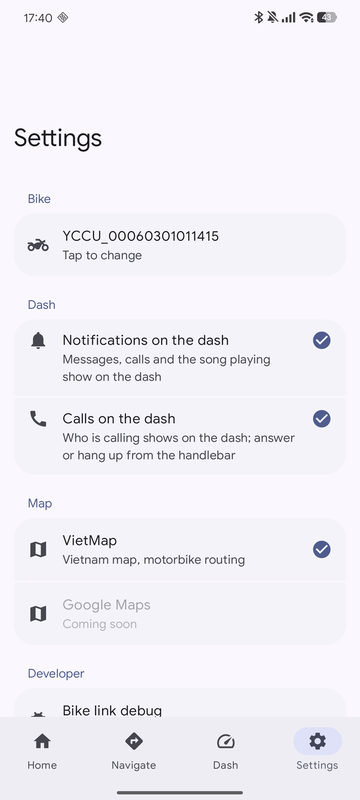
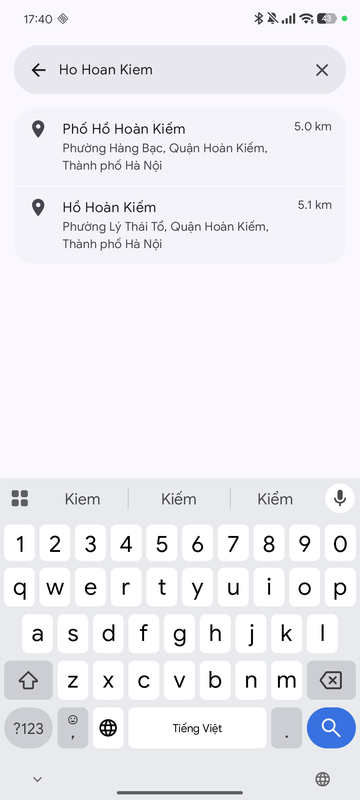

> **Credits.** NmaxConnect is based on two apps:
> - [SDMV DashConnect](https://play.google.com/store/apps/details?id=com.sdmv.qjnavigation) by SDMV (Google Play)
> - [NConnect](https://github.com/dmina97-cpu/nconnect-releases) by Phạm Minh Nam (GitHub)

<p align="center"></p>

# NmaxConnect

An Android app that brings navigation and phone features to the TFT dash of Yamaha bikes (NMAX, XMAX), without Y-Connect. It talks to the dash and the bike's control unit (CCU) over Bluetooth and streams a live VietMap map with turn-by-turn guidance to the dash.

Website: https://lamphung-phuc.github.io/nmax_connect/

<p>
  
  
  
  
</p>

## Install

1. Download the APK from [Releases](https://github.com/lamphung-phuc/nmax_connect/releases) and open it on an Android 8.0+ phone.
2. Allow **Nearby devices** and **Location**. Notifications and calls on the dash are optional.
3. On the bike, choose to connect a phone, then pair it in Android **Bluetooth** settings.
4. Close Y-Connect, StreetCross and similar apps (the bike talks to one app at a time), then tap **Connect**.

## Features

### Home
- One-tap **Connect**, with the state of each link (dash and control unit). **Auto connect** connects when the app opens.
- Your bike shown by its ID or your own nickname; the connection notification has a **Disconnect** action.

### Navigate


- Interactive VietMap: GPS puck, day/night style, follow camera with tilt while guiding.
- Place search with live suggestions sorted nearest first, Home / Work / saved places as chips on the map, recent places, long-press to drop a pin.
- Share a place from Google Maps to open it in the app.
- Up to 3 motorcycle route options (time, distance, main roads, traffic), live congestion colors.
- Turn-by-turn guidance on the phone and on the dash, with automatic rerouting.

<br clear="right">

### Dash
- Live map streamed to the dash: track-up camera, speed-based zoom, zoom with the dash buttons, passed route greyed out.
- **Turns** panel: next turn arrow, distance and street.
- **Bike stats** panel while navigating: air and engine temperature, battery voltage, instant fuel economy (km/L), each switchable.
- Pick a destination from the dash menu: Home, Work, favourites, or gas stations within 5 km.
- Preview of exactly what the dash shows.

### Bike (control unit)
- Connects like Y-Connect (SPP bootstrap, BLE, bonding, authentication) alongside the dash link.
- Bike data: odometer, battery, engine/air temperature, engine speed, fuel economy.
- **Bike** tab: maintenance reminders by km for engine oil, gear oil, air filter, CVT belt and spark plug, from the odometer.
- Phone on the dash: chat notifications, the song playing with next/previous/play/pause, phone battery/volume/signal/headset status, and weather.
- **Calls on the dash**: caller name or number, missed calls, answer / reject / hang up from the handlebar, call volume and mic mute.
- Answers the bike's clock and language requests.

### App
- Offline map of your area (30 × 30 km) for riding without signal.
- Help (**?**) on every screen with illustrated tips.
- Tap **Settings → Version** to check for an update: shows what's new and downloads the APK from the latest release.
- English and Vietnamese, Material 3 with light/dark theme.

## Build

Requirements: JDK 17+, Android SDK (compile/target 37, min 26).

```sh
./gradlew assembleDebug       # or assembleRelease (signed with the debug key for now)
./gradlew testDebugUnitTest   # unit tests
./gradlew detekt ktlintCheck  # lint (also the pre-commit hook: git config core.hooksPath .githooks)
```

Keys go in the gitignored `local.properties`; see [docs/setup-keys.md](docs/setup-keys.md). Routing and search go through a Cloudflare Worker that holds the VietMap API key: [`proxy/vietmap`](proxy/vietmap) (`node --test proxy/vietmap/test/index.test.mjs`, deploy with `npx wrangler deploy`).

## Repository

| Path | What |
|---|---|
| `app/` | The Android app (Kotlin, Jetpack Compose, Material 3, Hilt, Coroutines/Flow) |
| `app/.../core/protocol/` | TFT and CCU protocol codecs (pure Kotlin, unit-tested) |
| `app/.../core/bike/` | Bluetooth links to the dash and the control unit |
| `proxy/vietmap/` | Cloudflare Worker in front of the VietMap API |
| `site/` | Landing page, deployed to GitHub Pages |
| `docs/` | Protocol spec, roadmaps, UI spec, key setup, VietMap reference |
| `apk/` | Protocol notes from Garmin StreetCross and Yamaha Y-Connect |

More: [CHANGELOG](CHANGELOG.md) · [Roadmap](docs/roadmap.md) · [Bike protocol](docs/bike-protocol.md)

Not affiliated with Yamaha. Maps © VietMap.
